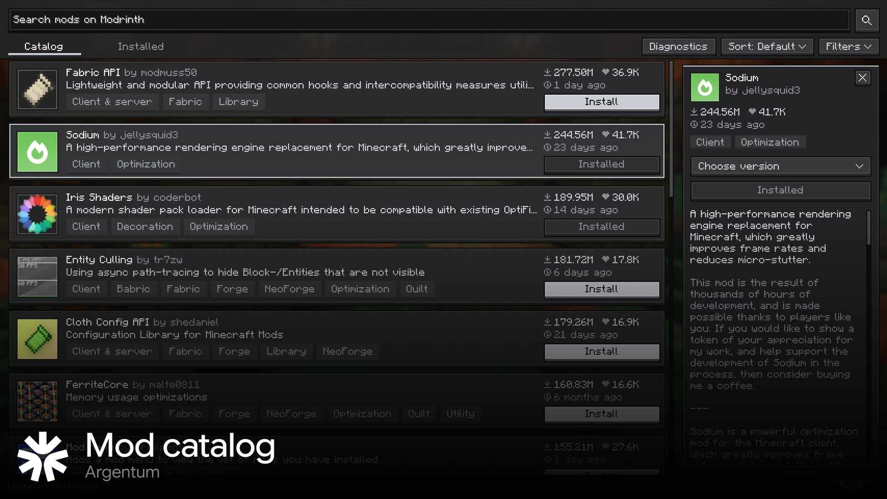
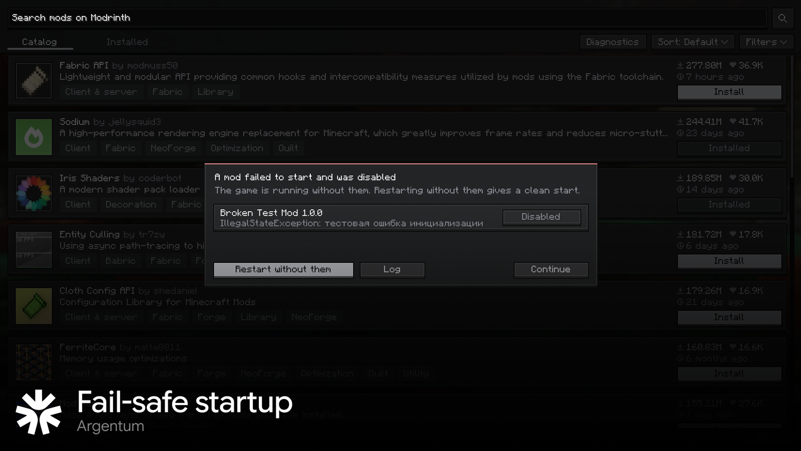
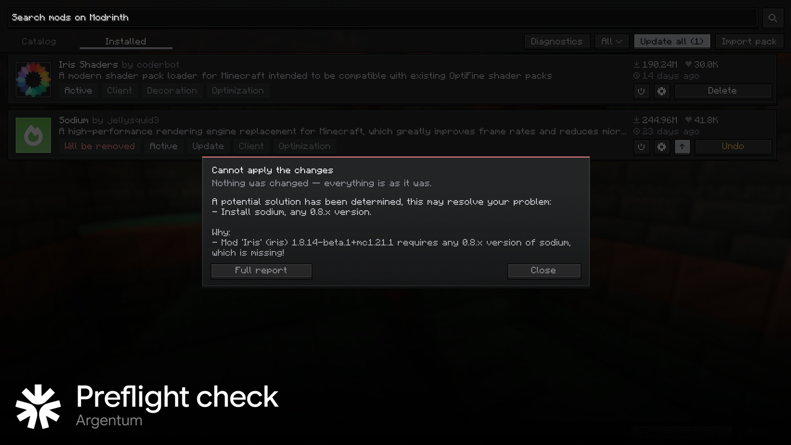
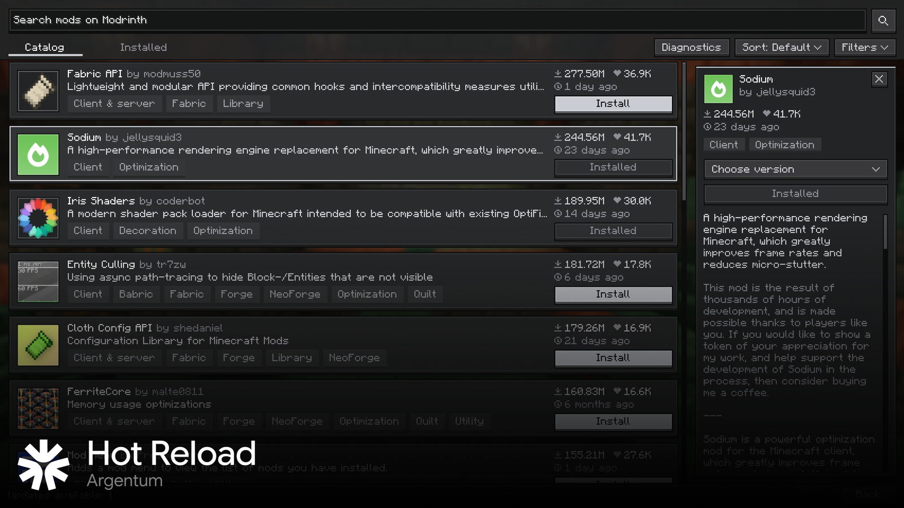
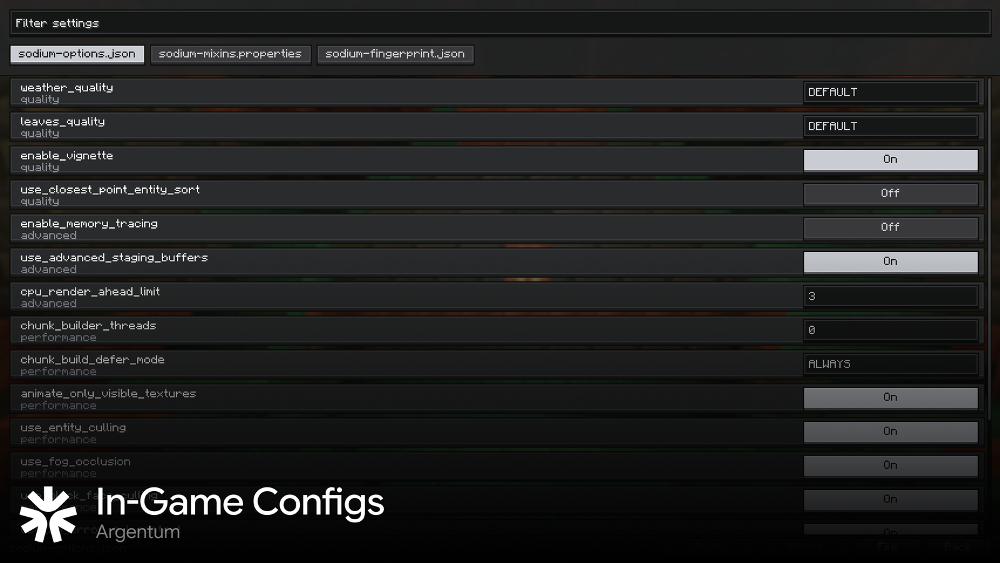

<div align="center">

<picture>
  <source media="(prefers-color-scheme: dark)" srcset="docs/assets/logo-white.png">
  
</picture>

# ArgentumLoader

**A Fabric-compatible mod loader with a built-in mod manager.**<br>
Pick mods in a catalog inside the game, press **Apply changes**, and the game switches to the new mod set by itself.<br>
A broken mod can no longer take the whole game down with it.

<a href="https://github.com/GanichGG/ArgentumLoader/releases/latest"></a>
&nbsp;
<a href="LICENSE-ARGENTUM.txt"></a>

*[Русская версия ниже](#русская-версия)*

</div>



<table>
  <tr>
    <td width="50%"></td>
    <td width="50%"></td>
  </tr>
  <tr>
    <td align="center"><b>Fail-safe startup</b><br>a mod that crashes is disabled, the game keeps running</td>
    <td align="center"><b>Preflight check</b><br>a change that cannot start is refused with a readable reason</td>
  </tr>
  <tr>
    <td width="50%"></td>
    <td width="50%"></td>
  </tr>
  <tr>
    <td align="center"><b>Hot reload</b><br>changes are applied with one seamless restart</td>
    <td align="center"><b>In-game configs</b><br>edit mod settings without leaving the game</td>
  </tr>
</table>

## What makes it different from Fabric Loader

Loader level (things a regular Fabric mod cannot do):

- **Fail-safe startup.** If a mod crashes while starting, the game keeps running. The mod (and everything that depends on
  it) is disabled and the game tells you which mods were disabled and why.
- **Preflight check.** Before any change is applied, the final mod set is run through the loader's own dependency
  resolver. If it cannot start, nothing is changed and you get a readable reason ("Install sodium 0.8.x - Iris needs it").
- **Locked files handled.** Windows keeps the jars of a running game locked. Removing or disabling such a mod is finished
  automatically when the new copy of the game starts.
- **Readable errors**, in English and Russian, instead of raw exceptions.
- **Startup profile** (`.argentum/startup-profile.txt`): where the launch time goes - loader phases, slowest mods,
  Mixin time.
- The loader provides the mod id `argentumloader`, so a mod can require it: `"depends": {"argentumloader": ">=1.0.0"}`.

Catalog (the bundled `argentum-client` mod, shown as **Argentum Mods** on the title screen):

- Search and install from [Modrinth](https://modrinth.com) with dependencies; sort, filter by category, version picker.
- **Queue and "Apply changes".** Install, remove, disable, enable and update mods; nothing happens until you confirm.
  Then the files are downloaded, the set is checked, a hidden copy of the game starts with the new mods and replaces the
  window seamlessly. If anything is wrong the changes are rolled back.
- Updates (checked by file hash), `.mrpack` import, disabling mods without deleting them.
- Crash diagnosis: after a crash it names the likely mod and offers to disable it.
- A built-in editor for mod settings (JSON, JSON5, TOML, properties).
- Languages: English and Russian (follows the game language).

## Versions

`1.0` = global version 1, sub-version 0, no stage letter - a stable release (`0.1B1` = global 0, sub-version 1, **B**eta
build 1; `A` is alpha). Mods see the same version as SemVer `1.0.0` under the id `argentumloader`; `fabricloader` stays at the Fabric Loader version this fork is based on.

## Compatibility

| | |
|---|---|
| Mods | Fabric mods (`fabric.mod.json`). Forge / NeoForge mods are **not** supported. |
| Minecraft | 1.21.1 |
| OS | Windows (other systems are untested) |
| Launchers | Prism Launcher, official launcher (profile) |

## Install

1. Download `ArgentumAnchor.exe` from the [latest release](https://github.com/GanichGG/ArgentumLoader/releases/latest)
   and check it against `SHA256SUMS.txt`.
2. Run it from anywhere (Downloads is fine). It finds your Prism Launcher instances and the official launcher's `.minecraft`;
   pick one in the list (the **...** button chooses any other folder) and press **Install**. The loader and the catalog are
   always installed together.
3. Prism: open *Edit Instance -> Version* - **ArgentumLoader** is there. Official launcher: choose the **ArgentumLoader**
   profile. Libraries are downloaded by the launcher on first start. To update, run the new installer again.
4. Start the game and press **Argentum Mods** on the title screen.

The installer is not code-signed yet, so Windows SmartScreen may warn about it (*More info -> Run anyway*).

### Uninstall

Prism: *Edit Instance -> Version*, remove **ArgentumLoader** and add Fabric Loader back; delete `argentum-client-*.jar`
from `mods`. You may also delete the `.argentum` folder and the `.argentum-*` files in `mods`.

## Roadmap

Plans, not promises: the order and the contents can change.

| Version | Theme | What is planned |
|---|---|---|
| **1.0** | Released | Fail-safe startup (incompatible mods are disabled by themselves); installer for instance launchers (Prism) and the official launcher. |
| **1.1** | Shaders and resource packs | Download shader packs and resource packs from the catalog, with the same queue and "Apply changes". |
| **2.0** | Convenience | Theme editor (customise the catalog interface); mod folders (grouping, enable / disable in bulk); folder manifest = modpack (`argentum-manifest.json`, instant switching); custom modpack CDN (your own update source for a build). |
| **3.0** | Hybrid core | Own core (not a fork - an implementation written to the specification); Fabric, NeoForge and Forge mods side by side in one client. |
| **4.0** | Ecosystem | Argentum mod API (plugins and loader extensions); server support (web panel, NeoForge / Forge on the server). |

## Privacy

No telemetry. The catalog talks only to Modrinth (search, downloads, and file hashes of your mods to find updates). See
[PRIVACY.md](PRIVACY.md).

## Build

JDK 21 is required.

```
./gradlew checkstyleMain checkstyleTest test finalJar      # loader -> build/libs
cd argentum-client && ../gradlew build                      # client mod
python tools/check_translations.py                          # every Lang.tr("...") has an English entry
```

Details for maintainers: [docs/RELEASING.md](docs/RELEASING.md). Changes: [CHANGELOG.md](CHANGELOG.md).
Security issues: [SECURITY.md](SECURITY.md).

### Translations

User-visible text is written in Russian in the code as `Lang.tr("original")`; the tables are
`src/main/resources/argentum/lang/<language>.json` (loader) and `argentum-client/src/main/resources/argentum/lang/<language>.json`
(client). To add a language, copy `en.json` to e.g. `de.json` and translate the values.

## License

ArgentumLoader is a fork of [FabricMC/fabric-loader](https://github.com/FabricMC/fabric-loader).

- ArgentumLoader is **All Rights Reserved**, (c) 2026 GanichGG ([LICENSE](LICENSE)): the catalog client, the Modrinth
  integration, the hot-loader, fail-safe startup, preflight, the installer and everything else written for this project.
  Using the unmodified official builds is permitted.
- The code that comes from Fabric Loader stays under the **Apache License 2.0** ([LICENSE-APACHE-2.0.txt](LICENSE-APACHE-2.0.txt));
  that licence cannot be removed from upstream code. [LICENSE](LICENSE) says which files these are.
- Bundled third-party libraries and fonts keep their own licences.

---

<div align="center">

<picture>
  <source media="(prefers-color-scheme: dark)" srcset="docs/assets/logo-white.png">
  
</picture>

# Русская версия

</div>

Fabric-совместимый загрузчик модов со встроенным менеджером модов. Выбираешь моды в каталоге прямо в игре, нажимаешь
**«Применить изменения»**, и игра сама переключается на новый набор модов - без ручных перезапусков. А сломанный мод больше
не может уронить всю игру.

## Чем отличается от Fabric Loader

В самом загрузчике (то, чего не сделает обычный мод):

- **Безопасный запуск.** Если мод падает при старте, игра продолжает работать: мод (и зависящие от него) отключается, а игра
  показывает, что отключено и почему.
- **Предпроверка.** Перед применением изменений итоговый набор прогоняется через настоящий разрешитель зависимостей
  загрузчика. Если он не запустится, ничего не меняется, а причина понятна («Установите sodium 0.8.x - он нужен Iris»).
- **Заблокированные файлы.** Windows держит jar запущенной игры. Удаление или отключение такого мода завершается само при
  запуске новой копии игры.
- **Читаемые ошибки** на английском и русском.
- **Профиль запуска** (`.argentum/startup-profile.txt`): куда уходит время запуска.
- Загрузчик предоставляет идентификатор `argentumloader`, мод может требовать его: `"depends": {"argentumloader": ">=1.0.0"}`.

Каталог (встроенный мод `argentum-client`, кнопка **«Моды Argentum»** на главном экране):

- Поиск и установка с [Modrinth](https://modrinth.com) вместе с зависимостями, сортировка, категории, выбор версии.
- **Очередь и «Применить изменения».** Установка, удаление, отключение, включение и обновление - только после
  подтверждения: скачивание, проверка набора, скрытая копия игры с новыми модами и бесшовная подмена окна. При ошибке
  изменения откатываются.
- Обновления (по хешам файлов), импорт `.mrpack`, отключение модов без удаления.
- Диагностика падений: называет вероятный мод и предлагает его отключить.
- Встроенный редактор настроек модов (JSON, JSON5, TOML, properties).
- Языки: английский и русский (по языку игры).

## Совместимость

Моды Fabric (`fabric.mod.json`); моды Forge / NeoForge **не поддерживаются**. Minecraft 1.21.1. Windows. Prism Launcher и
официальный лаунчер (профиль).

## Установка

1. Скачай `ArgentumAnchor.exe` из [последнего релиза](https://github.com/GanichGG/ArgentumLoader/releases/latest) и
   сверь с `SHA256SUMS.txt`.
2. Запусти его откуда угодно (из «Загрузок» тоже можно). Он сам находит инстансы Prism Launcher и `.minecraft`
   официального лаунчера: выбери нужный в списке (кнопка **...** - любая другая папка) и нажми **Установить**. Загрузчик и
   каталог ставятся всегда вместе.
3. Prism: *Edit Instance -> Version* - там появится **ArgentumLoader**. Официальный лаунчер: профиль **ArgentumLoader**.
   Чтобы обновиться, запусти новый установщик ещё раз.
4. Запусти игру и нажми **«Моды Argentum»** на главном экране.

Установщик пока без подписи, поэтому SmartScreen может предупредить (*Подробнее -> Выполнить в любом случае*).

Удаление: в Prism убери ArgentumLoader из *Edit Instance -> Version*, верни Fabric Loader и удали `argentum-client-*.jar` из
`mods`. Папку `.argentum` и файлы `.argentum-*` в `mods` тоже можно удалить.

## Планы

Это планы, а не обещания: порядок и состав могут измениться.

| Версия | Тема | Что планируется |
|---|---|---|
| **1.0** | Вышла | Безопасный запуск (несовместимые моды отключаются сами); установщик для инстанс-лаунчеров (Prism) и обычного лаунчера. |
| **1.1** | Шейдеры и ресурспаки | Скачивание шейдеров и ресурспаков из каталога, с той же очередью и «Применить изменения». |
| **2.0** | Удобство | Редактор тем (кастомизация интерфейса каталога); папки модов (группировка, массовое вкл/выкл); манифест папки = модпак (`argentum-manifest.json`, мгновенное переключение); кастомные CDN модпаков (свой источник обновлений для сборки). |
| **3.0** | Гибридное ядро | Своё ядро (не форк, а реализация по спецификации); моды Fabric, NeoForge и Forge одновременно в одном клиенте. |
| **4.0** | Экосистема | API модификации Argentum (плагины и расширения загрузчика); серверная поддержка (веб-панель, NeoForge / Forge на сервере). |

## Приватность и лицензия

Телеметрии нет, подробности в [PRIVACY.md](PRIVACY.md). ArgentumLoader - **All Rights Reserved** ([LICENSE](LICENSE)); код,
пришедший из Fabric Loader, остаётся под Apache 2.0 ([LICENSE-APACHE-2.0.txt](LICENSE-APACHE-2.0.txt)), список файлов - в
[LICENSE](LICENSE).
